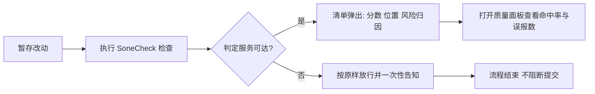

# v0.2.0 特性规格 — calibrated-judgment

> 结构唯一权威：`dev-meta/docs/02-version-rules.md` §4。
> ⚠️ 本文件不得出现 `Transaction Flow` / `TF` / `Step` 章节（施工拆分属 `400-build.md`）。

让插件**第一次在真实判定服务上度量自己判得准不准**：把「这段改动被谁调用、是否对外导出、是否碰敏感路径」三个本地事实一并交给判定服务，在真实端点上标定误报率，并把命中率与误报数固化成可查看的质量指标。

**本版本不包含**：上下文作用域行数可配置、误报反馈入口、运行期结构化日志（O2 埋点）——三者与「度量质量」主线耦合弱，顺延后续版本；Marketplace 上架仍待 `VSCE_PAT`。

---

## 背景（小白向）

插件会在提交前挑出最值得复核的几块改动。此前挑得好不好只有开发者的感觉，没有数字。

上一版虽接上了真实判定服务（真正给改动打分的外部程序），但验收全程对着本地仿真端点（假扮该服务的本机程序）跑——真实服务有多快、会不会限流，产品链路从未真正验证过。

本版让插件首次能在真实服务上度量自己准不准，并把结果固化成可查看指标。

## 用户旅程（用例）

| 分支 | 触发条件 | 期望行为 |
|---|---|---|
| 主路径 | 服务可达且三个本地事实取到 | 清单含 7 类风险归因；质量面板可查命中率与误报数 |
| 降级 | 服务不可达 / 超时 / 限流 / 响应不合规 | 一律放行 + 一次性提示，绝不阻断提交（`INV-01` / `INV-04`） |
| 预算压缩 | 三个本地事实挤占上下文预算 | 上下文变短但判定照常进行；出站上限恒为 2048 字节（`INV-02`） |
| 宽限 | 未配置 Key | 首次一次性引导，后续仅状态栏提示，检查静默跳过（`ERR-08`） |

> 三个本地事实即 `local_metadata`：`caller_count`（被谁调用）、`is_exported`（是否对外导出）、`touches_sensitive_path`（是否碰敏感路径）。前两项需向编辑器查询符号信息（语言服务器），第三项为本地路径匹配。

---

## 1. 架构锚点（本版本触及的架构面）

> 只登记「动到哪 + 红线」，不写为什么这样设计（论证属 `300-design.md`）。

| 维度 | 本版本触及 | 硬约束 / 红线 |
|---|---|---|
| 分层 | 不新增层，三层纪律延续；语言服务器访问属 `infra`（唯一可 `import vscode` 的层） | 严格单向 `UI → Core → Infra`；`core` 不得引用 `vscode`；跨层只经 Facade |
| 模块 | **新建** `src/infra/symbols.ts`（经语言服务器取 `caller_count` / `is_exported`）与 `src/core/quality.ts`（命中率与误报计数累计）；**改** `core/contextBuilder.ts`（出站预算在 `context_code` 与 `local_metadata` 间重分配）、`core/riskEngine.ts`（接入本地事实与质量计数）、`core/threshold.ts`（归因枚举扩至 7 项的筛选）、`infra/jevClient.ts`（`criteria` 取值集合 5 → 7，签名不变）、`ui/riskList.ts`（两项新归因的显示文案）、`src/constants.ts`（预算与质量阈值增量） | 判定参数只取自 `constants.ts`（`INV-07`）；语言服务器与文件系统访问只出现在 `infra` |
| 门面 | `src/core/index.ts` / `src/infra/index.ts` 增量 re-export 新公开符号 | 层间调用只经 Facade |
| 契约 | 兑现既有登记：`API-01` Request 的 `local_metadata` 三字段由「已定义未发送」转为实际发送；`03` §2.4 的 `CONFIG_CHANGE` / `HIGH_FANOUT` 两项归因生效，`criteria` 的 key 集合 5 → 7；`CFG-01` 的 `sensitivePathPatterns` 首次获得生产消费方。`INV-02` **不变式本身不变**（2048 字节不上调），仅登记预算分配细则。**新增**：质量指标持久化载体契约（待定，见下） | 契约 ID 与 `03_CONTRACTS_AND_API.md` 逐字一致；`API-01` 公开签名不得变更（`ADR-002`）；`criteria` 扩项属**兑现** `03` §2.4 既有登记，不算破坏性变更 |
| API | 无新增命令；归因枚举的显示文案补 2 项 | 命令 ID 与契约逐字一致；Key 任何情况下不回显明文（`INV-03`） |

### 1.1 明确不做（技术 / 范围）

| 项 | 类型 | 理由 / 归属 |
|---|---|---|
| 上调 payload 上限 | 技术 | **守住 `INV-02` 硬不变式**——2048 字节是隐私边界（`00` §5），不为功能腾空间；预算冲突在 `context_code` 侧解决 |
| 上下文作用域行数可配置 | 范围 | 与「度量质量」耦合弱——度量需要的是更准的判据，不是更长的上下文；顺延后续版本 |
| 误报反馈入口 | 范围 | 依赖质量指标先跑出可信基线，否则反馈无参照；顺延后续版本 |
| 运行期结构化日志（`observe` / `inspectionId` / 7 个埋点） | 范围 | 属诊断基础设施，与质量度量不是同一件事；本版的计数只服务于质量指标。顺延后续版本（`06` §6 为版本无关能力演进，无需改动） |
| Marketplace 上架 | 外部依赖 | 待 `VSCE_PAT`；本版收口 = VSIX + annotated tag（同前两版） |
| 服务端 Proxy / 托管 Key | 范围 | `00` §5——BYOK 不变，`v1.0.0` 起解除 |
| 官方 Jev SDK | 技术 | `ADR-004` 维持有效：手写 `fetch` |

---

## 2. 功能验收标准

> **验收前提**：真实 Jev API Key 可用（`ADR-007` 挂账项的前提条件已满足）。标注「产品链路」的验收项一律走**装配层 + SecretStorage + 默认 endpoint** 的完整链路，不得用旁路脚本代替——`v0.1.1` 的教训是旁路测量证明不了产品可用。

| 验收项 | 验证方法 | 通过标准 |
|---|---|---|
| 本地事实入载荷 | 产品链路执行一次检查，从上游侧读取实发请求体 | 三个字段均出现且取值正确；`caller_count` 为语言服务器返回的真实引用数（非启发式估算） |
| 出站上限不被破坏 | T1 单测断言 + 上游侧字节计数 | 任一块序列化后 ≤ 2048 字节（**含** `context_code` 与 `local_metadata`） |
| 上下文预算压缩 | T1 单测对比压缩前后 | 变更行本身永不被截断（既有保证不变）；压缩幅度有实测记录 |
| 归因枚举扩展 | 产品链路检查含配置变更 / 高扇出引用的 hunk | 清单可出现 `CONFIG_CHANGE` / `HIGH_FANOUT`；请求侧 `criteria` 含 7 个 key；清单文案有对应显示名 |
| 产品链路首验 | 真实 Key + 默认 endpoint 端到端跑通 | 清单真实返回；无装配层、归一化或密钥生命周期异常 |
| 超时余量复核 | 真实端点 ≥ 30 次调用 | p90 与重试上界不击穿 `REQUEST_TIMEOUT_MS = 500`；余量数值有留痕。**若不成立**：按 `ADR-007` 只动 `constants.ts` 与 `03` 注记，不动结构 |
| 真实 `429` 行为 | 真实端点触发限流 | 退避 1 次后降级放行，绝不阻断 |
| 误报率标定 | 50 次**带人工标签**的真实提交样本 | 目标值已回填 `05` M3 判据且附实测依据，`05` 中不得仍为 TODO。**前提**：标签须人工标注，此项含人工成本 |
| 质量指标可见 | 打开质量面板 | 命中率与误报数可查；数据来源可追溯到具体检查 |
| 语言服务器不可用 | 在无语言服务器的语言（如纯文本）上检查 | `caller_count` / `is_exported` 取保守缺省值，检查照常进行，不阻断、不抛未分类异常 |
| 降级不阻断 | 真实端点不可达时执行检查 | 按 `ERR-01`~`ERR-05` 放行 + 一次性提示 |
| 工作区只读 | 检查前后对比 `git status` | 工作区无任何变化（`INV-05`） |

---

## 3. 架构验收标准

| 验收项 | 通过标准 |
|---|---|
| `INV-02` 未被破坏 | 2048 字节上限未上调；单测断言在 `local_metadata` 加入后仍成立 |
| 无硬编码判定参数 | 预算分配、质量阈值、模型 ID 等均取自 `constants.ts`（`INV-07`） |
| 语言服务器访问不破分层 | `symbols.ts` 之外无任何 `import vscode`；`core` / `infra` 无反向 import（`GUARD-01`） |
| 配置读取单口 | `getConfiguration` 只出现在 `infra/configSource.ts`（`GUARD-02`） |
| Key 零泄漏 | `src/` 中 `jevApiKey` 字面量只出现在 `infra/secrets.ts`（`GUARD-06`） |
| 新增失败面不静默 | 语言服务器失败以分类值表达并计入降级归因，不吞错、不抛未分类异常（`INV-04` 同等要求） |
| 契约状态一致 | `03` 中 `local_metadata` 与两项归因已兑现；无 `[PLANNED]` 残留 |
| T2 契约测试仍全绿 | 仿真端点场景下 `local_metadata` 缺席时的旧断言已按新契约更新，非删除绕过 |

---

## 4. DoD (Definition of Done)

- [ ] 背景（小白向）已确认（零前置知识可读，术语首次出现已紧跟白话解释）
- [ ] 用户旅程已确认（主路径 + 降级 / 预算压缩 / 宽限分支齐全，且与架构锚点无重复）
- [ ] 核心业务场景已确认（单一场景，一句话可述：**首次在真实判定服务上度量判定质量**）
- [ ] 架构锚点已确认（分层 / 模块 / 门面 / 契约 / API 均已登记）
- [ ] **质量指标持久化载体已定案并回写契约 SSOT**（本项**阻塞编码**，须在开工前完成）
- [ ] 受影响契约已回写至契约 SSOT（`local_metadata` 兑现、两项归因生效、`criteria` 5 → 7、`INV-02` 预算分配登记）
- [ ] 验收标准已确认（含「产品链路」与「旁路脚本」不得混用这一前提）
- [ ] 相关设计文档已评审通过（`300-design.md`）
- [ ] 测试策略已定义（见 `300-design.md` 测试策略章节）
- [ ] 关键测试场景已通过
- [ ] **误报率目标值已由带标签样本实测锁定并回填 `05`**（`05` M3 判据不得仍为 TODO）
- [ ] **`ADR-007` 挂账已销账**（产品链路冒烟 + 超时余量复核 + 真实 `429` 退避复核，三项证据齐备）